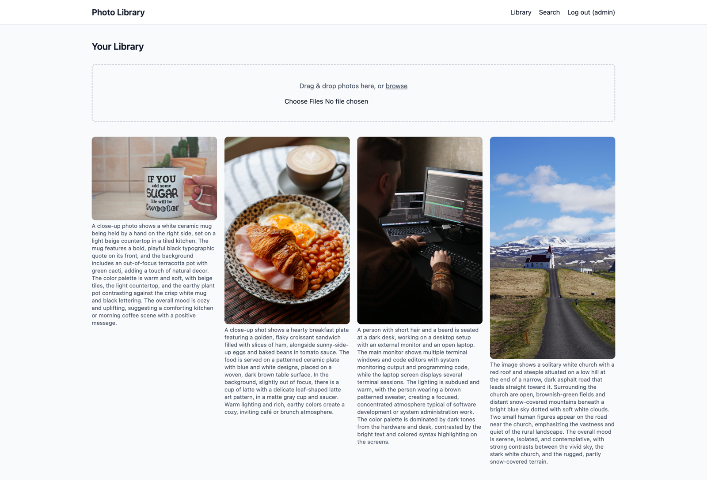
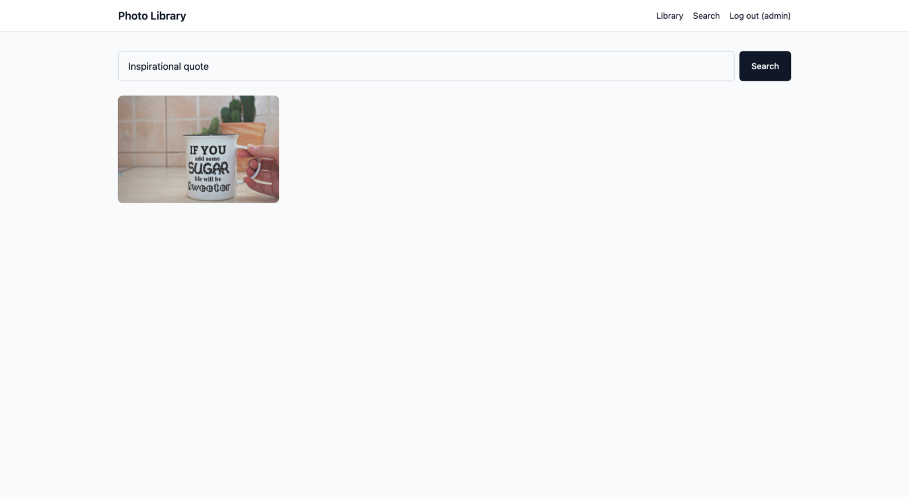
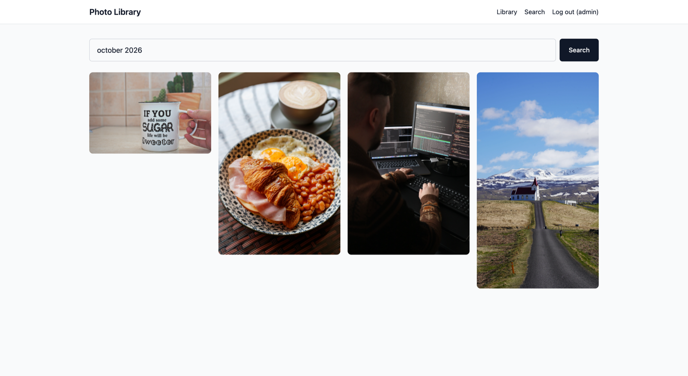
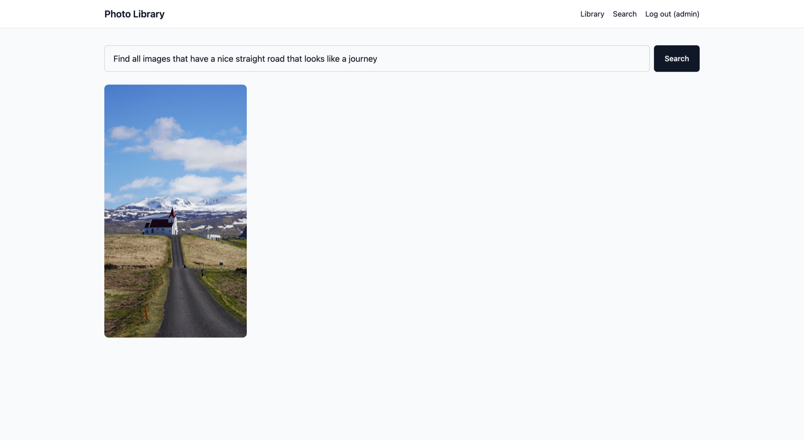
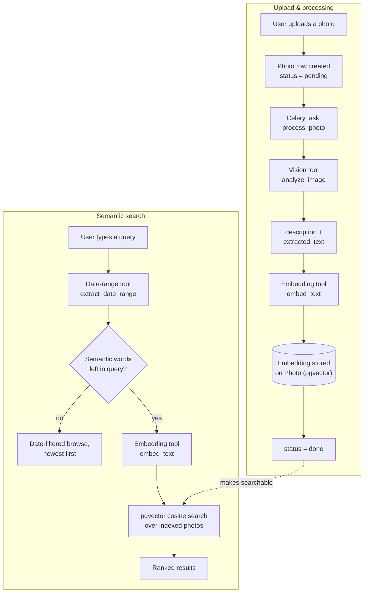

# Semantic Photo Library Search

[](https://github.com/KalobTaulien/Semantic-Photo-Library-Search/actions/workflows/ci.yml)

A Django app for searching your own photo library in plain English instead of tags or filenames — "the dog running on the beach", "receipts from last October", "birthday photos from this year". Every uploaded photo is described and transcribed by a vision model, embedded into a vector index, and matched against natural-language queries (with any date phrases parsed out and applied as a separate filter).

## Screenshots

<table>
  <tr>
    <td width="50%">
      
      <p align="center"><em>The Library — uploaded photos with their AI-generated descriptions</em></p>
    </td>
    <td width="50%">
      
      <p align="center"><em>Searching <code>Inspirational quote</code> — matched on text printed on the mug</em></p>
    </td>
  </tr>
  <tr>
    <td width="50%">
      
      <p align="center"><em>Searching <code>october 2026</code> — a pure date browse, newest first</em></p>
    </td>
    <td width="50%">
      
      <p align="center"><em>Searching <code>Find all images that have a nice straight road that looks like a journey</code> — matched by meaning, not keywords</em></p>
    </td>
  </tr>
</table>

## How to install

The app is designed to run via Docker Compose: a Postgres database with the `pgvector` extension, Redis as the Celery broker, the Django app itself, and a Celery worker for background photo processing.

**Prerequisites**

- Docker and Docker Compose
- Node.js 18+ (only needed to build the frontend assets)
- An OpenAI API key with access to a vision-capable chat model and an embeddings model

**Steps**

1. Clone the repo and copy the environment template:

   ```bash
   git clone git@github.com:KalobTaulien/Semantic-Photo-Library-Search.git
   cd Semantic-Photo-Library-Search
   cp .env.example .env
   ```

2. Edit `.env` and fill in:
   - `DJANGO_SECRET_KEY` — any long random string
   - `OPENAI_API_KEY` — your OpenAI key
   - `OPENAI_VISION_MODEL` — a current vision-capable chat model from your OpenAI account/docs
   - `OPENAI_EMBEDDING_MODEL` / `OPENAI_EMBEDDING_DIMENSIONS` — defaults (`text-embedding-3-small`, 1536) work out of the box

3. Build and start everything:

   ```bash
   docker compose up -d --build
   ```

   This brings up `db` (Postgres + pgvector), `redis`, `web` (runs migrations, then idles), and `celery_worker`.

4. Build the frontend (Tailwind CSS, htmx, Alpine.js, bundled by Vite into `frontend/dist`, which Django serves directly — there's no Node dev server at runtime):

   ```bash
   cd frontend
   npm install
   npm run build   # or `npm run dev` to rebuild on change while you work
   cd ..
   ```

5. Open a shell in the `web` container and start the dev server:

   ```bash
   make enter
   python manage.py createsuperuser   # optional, for /admin/
   python manage.py runserver 0.0.0.0:8000
   ```

6. Visit `http://localhost:8000` and create an account.

<details>
<summary>Running without Docker</summary>

You'll need a local Postgres instance with the `pgvector` extension enabled and a local Redis instance, with `DATABASE_URL` / `REDIS_URL` in `.env` pointed at them instead of the Docker service names. Then:

```bash
pip install -r requirements-dev.txt   # or requirements.txt without ruff
python manage.py migrate
python manage.py runserver
celery -A config worker -l info       # in a second terminal
```

</details>

## How to use

1. **Sign up / log in** at `/accounts/signup/`.
2. **Upload photos** from your Library (the home page) — drag and drop, or browse for files. Multiple files can be uploaded at once.
3. Each photo appears immediately with a "Processing…" overlay. In the background, a Celery task asks a vision model to describe it and transcribe any visible text, then embeds that into the search index. The card polls its own status every few seconds and updates automatically once it's done (or flags it as failed).
4. **Search** your library from the Search page using plain language:
   - By content: `a dog running on the beach`
   - By text visible in the photo: `the parking receipt from the garage`
   - By date: `photos from last month`, `July 2024`, `this week`, `2023`
   - Combined: `birthday cake photos from last year`
5. Click any result to view the full image alongside its description and any extracted text.
6. If you change the vision prompt, the vision model, or the embedding model, re-embed your existing library:

   ```bash
   python manage.py reprocess_photos                 # every photo
   python manage.py reprocess_photos --photo-id 42    # just one
   ```

## Process overview



## Tooling

### Pipeline tools

These are the building blocks that turn an uploaded photo into something searchable, and a typed query into a ranked result set:

- **Vision analysis tool** — [`photos/services.py::analyze_image`](photos/services.py). Wraps `ChatOpenAI` (LangChain) with structured output against the `ImageAnalysis` schema, pointed at `OPENAI_VISION_MODEL`. From raw image bytes it returns, in one model call, a 2–4 sentence description (subjects, setting, objects, colors, mood) and a verbatim transcription of any visible text — signs, labels, screens, documents, handwriting.
- **Text embedding tool** — [`photos/services.py::embed_text`](photos/services.py). Wraps `OpenAIEmbeddings` against `OPENAI_EMBEDDING_MODEL` (default: `text-embedding-3-small`, 1536 dimensions). Used both when indexing a photo's description/extracted text and when embedding the semantic part of a search query, so both land in the same vector space.
- **Date-range extraction tool** — [`search/dates.py::extract_date_range`](search/dates.py). A regex-based natural-language date parser: relative windows ("last 3 days", "past 2 weeks"), fixed periods ("today", "this month", "last year"), and explicit months/years ("March 2025", "2024"). Strips the matched phrase and filler words (like "photos of") out of the query so whatever's left can be judged on its own.
- **Async processing task** — [`photos/tasks.py::process_photo`](photos/tasks.py). Runs the vision and embedding tools off the request/response cycle, with automatic retry (3 attempts, exponential backoff with jitter) on transient OpenAI errors, and records a terminal failure on the `Photo` row rather than raising.
- **Retrieval tool** — [`search/retrieval.py::retrieve_photos`](search/retrieval.py). Orchestrates the above: pulls a date range out of the query and filters by it, then either returns a plain date-ordered browse (if nothing semantic is left to search for) or ranks the remaining photos by cosine distance against the query embedding, capped at a distance threshold so loosely related photos don't crowd out genuine matches.

### Developer tooling

- **Makefile** — `make enter` opens a shell in the running `web` container.
- **`manage.py reprocess_photos`** — re-runs the vision and embedding tools for existing photos (optionally scoped with `--photo-id`); use it after changing the analysis prompt or either model.
- **Ruff** — formatter and linter for the Python codebase, configured in `pyproject.toml`. A Claude Code `PostToolUse` hook (`.claude/settings.json`) auto-formats any `.py` file on write/edit, and CI (`.github/workflows/ci.yml`) re-checks formatting with `ruff format --check --diff` on every push and pull request to `main`.
- **Docker Compose** — four services: `db` (Postgres 16 + pgvector), `redis` (Celery broker/result backend), `web` (the Django app), and `celery_worker` (runs `process_photo` tasks).
- **Vite** (`frontend/`) — bundles Tailwind CSS, htmx, and Alpine.js into `frontend/dist`; Django serves the built assets directly via `django-vite`, so no Node process is needed at runtime.
